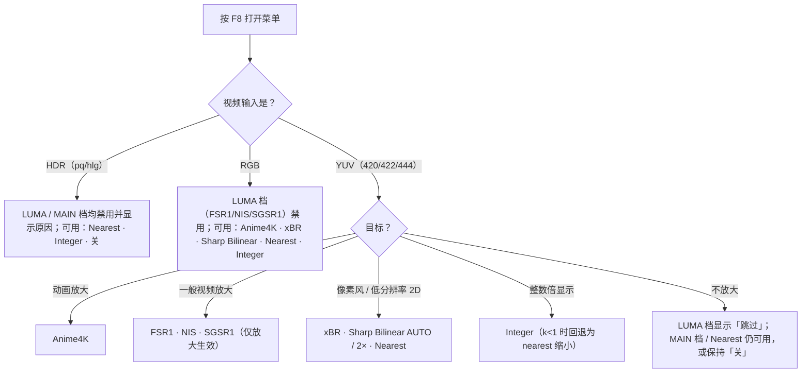

# scale-selector — mpv 缩放算法选择器

[](https://github.com/kkiwkK1/mpv-scale-selector/blob/main/LICENSE)
[](https://github.com/kkiwkK1/mpv-scale-selector/releases)
[](https://mpv.io)
[](#系统要求)
[](#质量信息)

**一句话**：一个 mpv Lua 插件——按 **F8** 弹出菜单，在「关」和 9 个缩放档位之间一键切换；另有 2 个占位项显示为不可选并注明原因。菜单显示的状态与实际生效状态一致。

**解决什么问题**：在 mpv 里更换缩放/放大算法，通常要编辑 `mpv.conf`、记忆 shader 文件路径，或维护多组手动 `input.conf` 绑定，链未生效时也没有直观反馈。本插件把这些操作收进一个菜单：FSR1 / NIS / SGSR1 / Anime4K / xBR / Sharp Bilinear AUTO / Sharp Bilinear 2× / Integer / Nearest 共 9 个档位的定义内建于插件，选中即应用；菜单标出当前档，禁用、跳过与回退均显示原因。另有 LS1、BCAS 两个占位项因无公开源码或出处未核实而保持不可选（见[档位总表](#档位总表)）。

## 目录

- [这是什么](#这是什么)
- [系统要求](#系统要求)
- [安装](#安装)
- [档位总表](#档位总表)
- [选哪个档位](#选哪个档位)
- [键位与脚本接口](#键位与脚本接口)
- [配置参考](#配置参考)
- [兼容性说明](#兼容性说明)
- [质量信息](#质量信息)
- [第三方引用](#第三方引用)
- [FAQ](#faq)
- [反馈与更多文档](#反馈与更多文档)
- [English](#english)

## 这是什么

mpv 的画质高度可调，但缩放算法散落在 `scale` / `cscale` / `dscale` 选项与第三方 shader 链中，切换一次就要改一次配置。scale-selector 把常用算法整理成一个运行时菜单：

- **12 项菜单** = 关 + 9 个可选档位 + 2 个永久禁用占位（LS1 / BCAS，显示禁用原因）
- **状态显示**：档位激活后按 `vo-passes` 核对本链 pass 确实存在；编译失败或未生效时自动回滚到上一稳定状态，无半生效残留；仅放大档非放大时显示「跳过」而不是伪激活
- **状态机**：off / active / external / fallback 四态；接管前快照「托管属性」（插件接管期间代为设置、选「关」时逐字恢复的那组 mpv 属性，如 `glsl-shaders`、`scale`）；检测到外部修改（如你自己绑定的手动链）时让出，不覆盖、不清链
- **一键安装器**（Windows）：21 项文件清单、逐文件 sha256、三态安装、`-Verify` 校验、`-Uninstall` 卸载、幂等重跑即升级

## 系统要求

| 项 | 要求 |
|---|---|
| 操作系统 | **Windows**（全部验证在 Windows 完成）。Linux / macOS 未验证，可按[手工安装](#方式二手工安装三步)自行复制文件 |
| mpv 版本 | 验证环境为 mpv git 快照构建 `v0.40.0-393-gad59ff1b4` + libplacebo `v7.357.0`——即 v0.40.0 之后第 393 个提交的开发版，**不是官网正式版本号**。官网正式 release（v0.40.0 或其它版本）未验证，本插件不声明任何版本下限；遇到问题时请附 mpv 完整版本号反馈（见[反馈与更多文档](#反馈与更多文档)） |
| 渲染后端 | `vo=gpu-next`（验证环境固定 `gpu-api=vulkan`）；其它 VO（含传统 `vo=gpu`）未验证，建议使用 `vo=gpu-next` |
| GPU | 各档 shader 在启动时编译；NIS 档为 compute shader 实现，需要支持 compute 的 GPU/驱动；编译失败自动回滚并显示原因 |
| Lua | mpv 需以 LuaJIT 或 Lua ≥5.2 构建（官方 Windows 构建为 LuaJIT）；PUC Lua 5.1 构建上 Integer 档 `video-zoom` 计算存在偏差（仅影响该档，见[兼容性说明](#兼容性说明)） |
| 运行测试（可选） | Python 3，仅标准库 |

`mpv.conf` 最小片段（可直接复制）：

```ini
vo=gpu-next
```

## 安装

### 获取文件

```
git clone https://github.com/kkiwkK1/mpv-scale-selector.git
```

没有 git 也可以：到 [Releases](https://github.com/kkiwkK1/mpv-scale-selector/releases) 下载 v0.1.0 的 *Source code (zip)* 并解压。两种方式得到的目录内容相同。

**仓库（或解压目录）放在任意位置都可以**，不必也不应放进 mpv 配置目录——一键安装器会把所需文件自动复制进配置目录；选择手工方式时由你自己复制（见下）。

目标目录为 mpv 配置目录：Windows 默认 `%APPDATA%\mpv`；Linux / macOS 下通常为 `~/.config/mpv`（即 mpv 路径缩写 `~~/` 指向的位置）；portable 版 mpv 为其旁的 `portable_config` 目录。

### 方式一：一键安装器（Windows，推荐）

在仓库根目录运行（双击 `tools\install.bat` 亦可）：

```
powershell -ExecutionPolicy Bypass -File tools\install.ps1
```

| 参数 | 作用 |
|---|---|
| （无参数） | 安装：缺失文件复制 / 与源一致跳过 / 冲突文件先备份为 `<名>.bak-scale-install-<时间戳>` 再覆盖 |
| `-ConfigDir <目录>` | 指定 mpv 配置目录；**不指定时固定用 `%APPDATA%\mpv`，不会自动检测 portable 安装**——portable 版 mpv 必须用此参数手动指向其 `portable_config` 目录 |
| `-Yes` | 跳过交互确认（自动化调用请带上） |
| `-Verify` | 只读校验 21 项清单：不写盘、不确认 |
| `-Uninstall` | 卸载：先逐个哈希核对，只删除与源一致的清单文件；哈希不符（你改过的）会拒绝删除并逐项列出 |

行为要点：

- **升级 = 重跑同一条命令**，无需先卸载（幂等；一致文件零改动）
- 绝不触碰 `input.conf`、`mpv.conf`、既有脚本与既有 shader 等清单外文件；冲突才备份，从不静默覆盖
- 安装时检查 `input.conf` 是否已绑定 F8，发现冲突给出警告
- 运行环境为 Windows PowerShell 5.1（无外部依赖）；PowerShell 7（pwsh）未验证

**退出码**：

| 码 | 含义 |
|---|---|
| 0 | 成功 / 校验健康（含幂等零改动、卸载完成、Verify 21/21 一致） |
| 1 | 参数 / 环境 / IO 错误（未知参数、互斥、拒绝确认、APPDATA 缺失、拷贝/备份/核对失败） |
| 2 | 预检阻断（源文件缺失、与 resource-manifest 在案 sha256 不符＝源损坏、manifest 解析失败） |
| 3 | 仅 `-Verify`：21 项一个都不存在（未安装） |
| 4 | 仅 `-Verify`：部分存在或哈希不符（不一致） |

### 方式二：手工安装（三步）

把三组文件复制到配置目录的对应位置（保持相对结构；Linux / macOS 步骤相同）：

| 仓库内文件 | 复制到配置目录下 |
|---|---|
| `scripts/scale-selector.lua` | `scripts/` |
| `script-opts/scale-selector.conf`、`script-opts/scale-selector-gears.conf` | `script-opts/` |
| `shaders/` 整目录（含 `anime4k/` 子目录，共 18 个文件） | `shaders/` |

档位链以 `~~/shaders/…` 相对路径引用：**缺 `shaders/` 目录或对应文件时，相应档位失效**，菜单会显示回退原因。

### 安装后确认

**启动 mpv → 播放任意视频 → 按 F8 弹出菜单，即安装成功。**

- FSR1 / NIS / SGSR1 三个档位需要 YUV 格式的视频（yuv420p / 422 / 444 平面格式均可）；播放 RGB 视频时这三档显示为灰色不可选，这是设计行为（原因见[兼容性说明](#兼容性说明)）
- 启动日志固定出现 6 条「覆盖被忽略」告警——插件忽略对内建/占位档位的本地配置覆盖键，属预期行为，不是配置错误，无需处理

## 档位总表

| # | 菜单项（id） | 算法与适用 | 来源（上游） | 许可 |
|---|---|---|---|---|
| 1 | 关（`off`） | 恢复插件接管前的 `glsl-shaders` / `scale` / `cscale` / `dscale` 及 Integer 几何属性；不等于停止 mpv 必需的缩放与色彩管理 | — | — |
| 2 | LS1（`ls1`） | **不可选占位**：Lossless Scaling 的神经网络放大模型，无公开源码 / 权重 / 再分发许可，不提供 | — | — |
| 3 | FSR1（`fsr1`） | AMD FidelityFX Super Resolution v1.0.2（EASU+RCAS）；工作在 YUV 亮度通道（LUMA 档），仅放大生效，每轴 ≤2× 超出部分由 mpv scaler 接管；适用于一般视频放大 | [GPUOpen-Effects/FidelityFX-FSR](https://github.com/GPUOpen-Effects/FidelityFX-FSR)；mpv 移植 by [agyild](https://gist.github.com/agyild/82219c545228d70c5604f865ce0b0ce5) | MIT |
| 4 | NIS（`nis`） | NVIDIA Image Scaling v1.0.2，compute shader 实现，内含锐化段（不叠加 NVSharpen）；LUMA 档，仅放大；适用于一般视频放大 | [NVIDIAGameWorks/NVIDIAImageScaling](https://github.com/NVIDIAGameWorks/NVIDIAImageScaling)；mpv 移植 by [agyild](https://gist.github.com/agyild/7e8951915b2bf24526a9343d951db214) | MIT |
| 5 | SGSR1（`sgsr1`） | Qualcomm SGSR1（LUMA 适配版，单 pass）；LUMA 档，仅放大；适用于一般视频放大 | [SnapdragonGameStudios/snapdragon-gsr](https://github.com/SnapdragonGameStudios/snapdragon-gsr)；mpv 移植 by [agyild](https://gist.github.com/agyild/7715b6b1f38427839d58f80884902cab) | BSD-3-Clause |
| 6 | BCAS（`bcas`） | **不可选占位**：算法定义与出处未核实，无法确认其对应何种算法，不提供 | — | — |
| 7 | Anime4K（`anime4k`） | Anime4K 官方 stock v4 CTRL+1..6 精确链的零改动副本，面向动画放大（上游项目定位）；`anime4k_chain=a..f` 选链（默认 a = Mode A (HQ)）；MAIN 档：RGB 可用、HDR 拒用 | [bloc97/Anime4K](https://github.com/bloc97/Anime4K) | MIT ×8 + Unlicense ×2（以各文件头为准） |
| 8 | xBR（`xbr`） | Hyllian xBR-lv2，**3× 预缩放 + mpv 后续缩放**模式（xBR ≠ xBRZ）；适用于像素风 / 低分辨率 2D 图形；MAIN 档 | [libretro/glsl-shaders（xbr-lv2）](https://github.com/libretro/glsl-shaders/blob/master/xbr/shaders/xbr-lv2.glsl) | MIT |
| 9 | Sharp Bilinear AUTO（`sharpbilinear`） | 自动预缩放 `floor(输出高/输入高+0.01)`；倍率不足时菜单明示「退化为双线性」；适用于像素风整数倍预缩放；MAIN 档 | [libretro/glsl-shaders（Themaister）](https://github.com/libretro/glsl-shaders/blob/master/interpolation/shaders/sharp-bilinear.glsl) | Public domain |
| 10 | Sharp Bilinear 2×（`sharpbilinear2x`） | 固定 2× 预缩放（与 AUTO 分别命名、分别成文件）；MAIN 档 | 同上 | Public domain |
| 11 | Integer（`integer`） | 整数倍缩放：k = floor(min(窗口宽÷视频显示宽, 窗口高÷视频显示高))——视频显示尺寸取 mpv `video-out-params`（已含旋转/裁切/宽高比换算），k 即视频在窗口内能放大的整数倍数；按 k 倍放大（`video-unscaled=yes` + `video-zoom` + 三核 nearest）；k<1（窗口连 1 倍都放不下）回退为普通 nearest 缩小，不裁切；不受 RGB/HDR 限制 | mpv 原生属性（无第三方 shader） | — |
| 12 | Nearest（`nearest`） | `scale` / `cscale` / `dscale` 全 nearest（显式点采样，无 shader 链）；不受 RGB/HDR 限制 | mpv 内建 | — |

菜单顺序与 `script-opts/scale-selector-gears.conf` 的 `gears=` 一致。

表中「LUMA 档 / MAIN 档」是按处理位置的分组名：LUMA 档工作在 YUV 亮度通道，MAIN 档作用于 MAIN/PREKERNEL 处理阶段（放大后的 RGB 图像）；两类对 RGB / HDR 输入的可用性不同，见下方「输入适用性」。

**LS1 / BCAS 为什么永远灰显**：LS1 是 Steam 商业软件 Lossless Scaling 中的神经网络放大模型（官方称优化范围约 1×–2×），未公开源码、权重与移植/再分发许可，无法内置；BCAS 的全称与算法定义未核实。这两个档位因此不提供：无论本地配置怎么写，它们都保持禁用并显示固定原因——这是固定行为，不是「待实现」。CAS 的来源核查记录见 [licenses/CAS-SOURCE-NOTES.md](licenses/CAS-SOURCE-NOTES.md)（本仓库不分发 CAS 代码）。

**Anime4K 链模式**（`script-opts/scale-selector.conf` 的 `anime4k_chain=`，默认 a）：

| 值 | stock v4 手动键 | 模式 | 链组成差异（选链参考） |
|---|---|---|---|
| a | CTRL+1 | Mode A (HQ) | Restore（VL）恢复 → 放大；默认通用起点 |
| b | CTRL+2 | Mode B (HQ) | 同 a，恢复段换用 Soft（较柔和）变体 |
| c | CTRL+3 | Mode C (HQ) | 先降噪（Denoise）再放大；片源噪点较多时可试 |
| d | CTRL+4 | Mode A+A (HQ) | 在 a 上追加第二段 Restore；处理步骤最多 |
| e | CTRL+5 | Mode B+B (HQ) | 在 b 上追加第二段 Soft Restore |
| f | CTRL+6 | Mode C+A (HQ) | 降噪放大后再补一段 Restore |

CTRL+1..6 是 Anime4K 官方键位模板中的手动链绑定，**不是本插件提供的键位**；若你的 `input.conf` 里已有这类绑定，插件检测到后会进入「外部态」并让出（见 [FAQ](#faq)）。各链的文件组成定义于插件脚本内。六条链只是上述步骤组合不同：不确定时保持默认 a，需要降噪选 c，想要更重 / 更柔和的处理分别在 a↔d、b↔e 之间对比即可。

### 输入适用性（按输入格式自动判断）

- **LUMA 档（FSR1 / NIS / SGSR1，工作在 YUV 亮度通道）**：输入为 RGB 系像素格式或 HDR（gamma ∈ {pq, hlg}）时自动禁用并显示原因；仅放大生效，非放大时显示「跳过」
- **MAIN 档（Anime4K / xBR / Sharp Bilinear 两档）**：RGB 输入可用；HDR 输入自动禁用（Anime4K 的全部处理位于 MAIN/PREKERNEL 层，故归此类）
- **Nearest / Integer**：不受 RGB/HDR 限制；Integer 的黑边与 k<1 回退均在菜单注明

## 选哪个档位



## 键位与脚本接口

**菜单键位**：

| 键 | 作用 |
|---|---|
| F8 | 打开 / 关闭菜单（打开时光标停在当前生效档） |
| ↑ / ↓ 或滚轮 | 移动光标（跳过禁用项，首尾循环） |
| Enter / 小键盘 Enter | 激活当前档（选档后菜单保持打开，可继续切换） |
| Esc | 关闭菜单 |

- 菜单以 **✓** 标出当前档；菜单打开期间，7 个键（UP / DOWN / WHEEL_UP / WHEEL_DOWN / ENTER / KP_ENTER / ESC）被临时接管，关闭后原绑定原样恢复
- 菜单打开期间的插件消息显示在菜单状态头（菜单顶部的一行状态文字）内，不另弹 OSD

**脚本消息**（可写进 `input.conf`，也可供 uosc / IPC 自动化调用；与菜单 Enter 同一入口，禁用档会被拒绝并提示原因）：

| 消息 | 作用 |
|---|---|
| `script-message scale-selector-set <id>` | 直切指定档位；可用 id 按菜单顺序为：`off fsr1 nis sgsr1 anime4k xbr sharpbilinear sharpbilinear2x integer nearest`（`ls1` / `bcas` 为禁用占位，会被拒绝并提示原因） |
| `script-message scale-selector-cycle next` | 循环切下一档（`prev` 为上一档）；**循环顺序即菜单顺序**，跳过禁用档，首尾循环 |
| `script-message scale-selector-selftest` | 运行 124 项 Lua 内置自测，结果逐行输出到日志（见[质量信息](#质量信息)） |

示例：

```
Alt+1  script-message scale-selector-set fsr1
Alt+0  script-message scale-selector-set off
Alt+n  script-message scale-selector-cycle next
```

**换菜单键**：`script-opts/scale-selector.conf` 中 `key_menu=` 改为其它键；**留空**则不绑默认键，在 `input.conf` 写 `<键> script-binding scale_selector/scale-selector-menu`。mpv 出厂默认键位未启用 F8（官方键位模板 `etc/input.conf` 中的 `#F8 show-text ${playlist}` 是注释掉的示例）；F8 冲突只可能来自你自己的 `input.conf` 或其它脚本，安装器安装时会检查并警告。

## 配置参考

<details>
<summary>点开：script-opts 全部选项</summary>

**`script-opts/scale-selector.conf`**（标量选项）：

| 选项 | 默认值 | 作用 |
|---|---|---|
| `key_menu` | `F8` | 菜单开关键；留空则不绑定默认键，改用 `script-binding`（见[键位与脚本接口](#键位与脚本接口)） |
| `menu_font_size` | `22` | 菜单字号 |
| `anime4k_chain` | `a` | Anime4K 链模式 `a`..`f`（对应关系见[档位总表](#档位总表)）；非法值回退 `a` 并告警 |

**`script-opts/scale-selector-gears.conf`**（档位表）：

| 键 | 作用 |
|---|---|
| `gears=<id>[,<id>...]` | 菜单顺序；id 仅允许小写字母 / 数字 / 连字符 |
| `<id>_label` | 显示名（键名中 id 的 `-` 写作 `_`） |
| `<id>_mode` | `active` 或 `disabled`（显示但不可选）；缺省按 disabled |
| `<id>_reason` | 禁用 / 占位原因，菜单原样展示 |
| `<id>_set` | 该档位写入的属性（`属性=值`，`glsl-shaders` 另支持 `+=` 追加、`-=` 移除，激活时校验）；仅自定义档位可用 |

解析器的固定规则（不依赖该文件内容）：

- `off` 恒存在、恒在首项、恒可用，显示名固定「关」
- LS1 / BCAS 无论怎么写都保持禁用，使用内建固定原因文案
- 内建档位（fsr1 / sgsr1 / anime4k / nearest / nis / xbr / sharpbilinear / sharpbilinear2x / integer）的 `_label` / `_mode` / `_set` / `_reason` 覆盖一律无效并产生告警——档位链与标签以内建定义为准，本地配置无法替换或伪造
- 重复 id / 重复键只保留首个并告警；写新 id 按自定义档位处理（未配 `_mode=active` 时灰显）

</details>

## 兼容性说明

<details>
<summary>点开：插帧滤镜共存、RGB/HDR 自动禁用、Lua 版本</summary>

**与 RIFE 等插帧滤镜共存**：在 `mpv.conf` 级 `vf vapoursynth` RIFE 2× 插帧常驻的环境下，插件各档位正常激活与恢复，托管属性逐字保留，菜单键与插帧控制键互不抢键。LUMA 档的输入检查按**输出侧**像素格式判断：RGB 源经 RIFE 后输出 yuv444p，此时 LUMA 档可选可用；RGB 输入的禁用仅在直通（插帧关闭）时触发。

**RGB 视频上 FSR1 / NIS / SGSR1 灰显**：设计行为，不是故障。这三档工作在 YUV 亮度通道，RGB 或 HDR 输入时自动禁用并在菜单显示原因；换 YUV 素材（420 / 422 / 444 平面格式均可）即可激活。Anime4K / xBR / Sharp Bilinear 支持 RGB（HDR 仍禁用）。

**HDR 输入**：LUMA 档与 MAIN 档均禁用；Nearest / Integer 不受限。

**PUC Lua 5.1**：mpv 若以 PUC Lua 5.1 构建，Integer 档 `video-zoom` 会算错（源于 `math.log(k,2)` 在该版本的兼容性问题，仅影响 Integer 档的缩放比）；官方 Windows 构建（LuaJIT）不受影响。

**外部链让出**：若 `input.conf` 里存在直接 `change-list glsl-shaders` 的手动绑定（常见如 F6、Ctrl+1..6 的 Anime4K 手动链），触发时插件进入「外部态」并让出（外部优先，不静默覆盖）；属共存设计而非故障，没有这类绑定就不会遇到。

</details>

## 质量信息

- **单元测试**：共 697 个用例，分两个目录——`tests/` 646 个（插件行为与配套工具的单元测试）、`taskflows/` 51 个（补充用例），因此需分别运行（约 3 分钟，Python 3，仅标准库）：

  ```
  python -B -X utf8 -m unittest discover -s tests -p "test_*.py"
  python -B -X utf8 -m unittest discover -s taskflows -p "test_*.py"
  ```

- **Lua 内置自测**：124 例，随插件分发。播放中执行 `script-message scale-selector-selftest` 触发，逐例输出到日志（`selftest: PASS/FAIL <用例名>`），结尾输出汇总行（形如 `selftest finished: pass/fail cases: N failures: M`）。

- **安装完整性**：21 项安装清单逐文件 sha256；安装前预检对源文件与 `shaders/resource-manifest.json`、`shaders/p3-resource-manifest.json` 的在案哈希做交叉校验，源损坏时以退出码 2 阻断；`-Verify` 只读核对安装状态；`-Uninstall` 仅删除与源哈希一致的文件。

> 注：`shaders/` 下文件名的 `p2-` / `p3-` 前缀，以及个别文档名中的 `P1` / `P2` / `P3` 字样（如用户说明的文件名），均为仓库的分组编号，与算法版本、功能差异无关。

本项目未进行主观画质评价，不对画质做任何推荐。

## 第三方引用

本插件内嵌/适配的第三方着色器及其上游、许可与归属笔记如下（总表另见 [THIRD-PARTY-NOTICES.md](THIRD-PARTY-NOTICES.md)）；适配版仅追加溯源注释、固定参数与输出边界保护等不触及主算法的改动，各基文件 SHA-256 与逐条差异记录于对应许可笔记：

| 组件 | 本仓库资源 | 上游 | 许可 | 归属笔记 |
|---|---|---|---|---|
| AMD FSR 1.0.2 | `shaders/p2-FSR1.glsl`（适配版） | [GPUOpen-Effects/FidelityFX-FSR](https://github.com/GPUOpen-Effects/FidelityFX-FSR)；mpv 移植 [agyild gist](https://gist.github.com/agyild/82219c545228d70c5604f865ce0b0ce5) | MIT | [licenses/FSR1-LICENSE-NOTES.md](licenses/FSR1-LICENSE-NOTES.md) |
| NVIDIA Image Scaling 1.0.2 | `shaders/p3-NIS.glsl`（适配版） | [NVIDIAGameWorks/NVIDIAImageScaling](https://github.com/NVIDIAGameWorks/NVIDIAImageScaling)；mpv 移植 [agyild gist](https://gist.github.com/agyild/7e8951915b2bf24526a9343d951db214) | MIT | [licenses/NIS-LICENSE-NOTES.md](licenses/NIS-LICENSE-NOTES.md) |
| Qualcomm SGSR1 | `shaders/p2-SGSR1.glsl`（LUMA 适配版） | [SnapdragonGameStudios/snapdragon-gsr](https://github.com/SnapdragonGameStudios/snapdragon-gsr)；mpv 移植 [agyild gist](https://gist.github.com/agyild/7715b6b1f38427839d58f80884902cab) | BSD-3-Clause | [licenses/SGSR1-LICENSE-NOTES.md](licenses/SGSR1-LICENSE-NOTES.md) |
| Anime4K v4 | `shaders/anime4k/`（10 文件零改动副本） | [bloc97/Anime4K](https://github.com/bloc97/Anime4K) | MIT ×8 + Unlicense ×2（逐文件头） | [licenses/ANIME4K-LICENSE-NOTES.md](licenses/ANIME4K-LICENSE-NOTES.md) |
| Hyllian xBR-lv2 | `shaders/p3-xBR-lv2.glsl`（适配版） | [libretro/glsl-shaders](https://github.com/libretro/glsl-shaders/blob/master/xbr/shaders/xbr-lv2.glsl) | MIT | [licenses/XBR-LICENSE-NOTES.md](licenses/XBR-LICENSE-NOTES.md) |
| Sharp Bilinear | `shaders/p3-Sharp-Bilinear-AUTO.glsl`、`shaders/p3-Sharp-Bilinear-2x.glsl`（适配版） | [libretro/glsl-shaders（Themaister）](https://github.com/libretro/glsl-shaders/blob/master/interpolation/shaders/sharp-bilinear.glsl) | Public domain | [licenses/SHARP-BILINEAR-LICENSE-NOTES.md](licenses/SHARP-BILINEAR-LICENSE-NOTES.md) |

适配版哈希记录于 `shaders/resource-manifest.json` 与 `shaders/p3-resource-manifest.json`（安装器预检亦以此做源损坏检测；前缀说明见[质量信息](#质量信息)节注）。

## FAQ

<details>
<summary>点开：常见问题与排查</summary>

**F8 按了没反应？** 按序排查：

1. **脚本未加载**：确认 `scripts/scale-selector.lua` 与两个 `script-opts/scale-selector*.conf` 在位；看启动日志有无脚本报错（怎么看日志见下一条）。
2. **Fn / F-Lock**：笔记本 F8 被映射为媒体功能键时按 Fn+F8 或切换 F-Lock。判别法：先在 `input.conf` 加一行 `Alt+1 script-message scale-selector-set fsr1`（重启 mpv 后按 Alt+1），若能切档而真实键盘 F8 不能 → 问题在系统键盘层，不在插件。
3. **窗口焦点**：mpv 窗口必须在前台，菜单键由 mpv 进程接收。
4. **键位被改/被占**：检查 `input.conf` 是否绑定了 F8；或 `scale-selector.conf` 的 `key_menu=` 已被改动。改键/留空方法见「键位与脚本接口」。

**怎么看启动日志？** 在 cmd/PowerShell 里直接运行 `mpv`（而不是双击快捷方式），日志即打印在控制台；或在命令行加 `--log-file=<路径>` 落盘成文件（mpv 手册选项）。核对预期告警：`findstr /c:"覆盖被忽略" <日志文件>` 应命中 6 行。

**选档后几秒内自动弹回（提示原因）？** 这是链验证失败后的自动回滚：shader 编译失败或未生效——常见于老 GPU/驱动，或没有用 `vo=gpu-next`。排查顺序：更新 GPU 驱动 → 确认 `vo=gpu-next` → 换其它档位交叉定位（LUMA 档与 MAIN 档资源不同）→ 在日志中找 libplacebo/shader 编译报错行。插件会回滚到上一稳定状态，无半生效残留。

**选档时突然变成「外部态」？** 这些键不是本插件提供的——它们来自你自己在 `input.conf` 里绑定的手动 Anime4K 链（常见如 F6、Ctrl+1..6，直接 `change-list glsl-shaders`）。此类外部改动会让插件让出（外部优先，不静默覆盖），属共存设计而非故障；没有这类绑定就不会遇到。

**启动日志 6 条「覆盖被忽略」告警？** 预期行为：插件忽略对内建/占位档位的本地配置覆盖键的固定告警，无需处理。

**F8 会和别的绑定冲突吗？** 冲突只可能来自你自己的 `input.conf` 或其它脚本（mpv 出厂默认未启用 F8，完整说明见「键位与脚本接口」）；安装器安装时会检查并警告。可把 `key_menu=` 改为其他键，或留空改用 `script-binding scale_selector/scale-selector-menu`。

**portable 版 mpv 怎么装？** 安装、校验、卸载都支持 `-ConfigDir`，把它指向 portable 配置目录即可：`powershell -ExecutionPolicy Bypass -File tools\install.ps1 -ConfigDir "<mpv.exe 所在目录>\portable_config"`（`-Verify`/`-Uninstall` 同参数）。

**怎么卸载？** `powershell -ExecutionPolicy Bypass -File tools\install.ps1 -Uninstall`——先逐个哈希核对，只删除与源一致的 21 项清单文件；哈希不符的（你改过的）会拒绝删除并逐项列出，确认不要后可按清单路径手动删除。备份与 `input.conf`/`mpv.conf`/既有文件从不被动。升级产生的 `.bak-scale-install-<时间戳>` 备份会累积在原目录，可自行删除；`scripts\` 下的 `.bak` 备份会被 mpv 的目录扫描看到并在日志里留下一条无害的加载错误，删除备份即消失。

**有菜单截图吗？** 暂无；菜单为 OSD 文字列表（档位名 + ✓当前标记 + 菜单状态头），安装后播放任意视频按 F8 显示的就是实际界面。

</details>

## 反馈与更多文档

- **问题反馈**：请到 [GitHub Issues](https://github.com/kkiwkK1/mpv-scale-selector/issues) 提交，附上 mpv 版本、操作系统与启动日志（`mpv --log-file=<路径>`），可加快定位
- [用户说明：状态机、输入适用性与恢复语义细节](docs/插件/缩放选择器-P3用户说明.md)
- [发布说明 v0.1.0](docs/发布说明-v0.1.0.md)
- [第三方组件声明 THIRD-PARTY-NOTICES.md](THIRD-PARTY-NOTICES.md)

## English

**What is this?** A scaling-mode selector plugin for [mpv](https://mpv.io). Switching scalers in mpv normally means editing `mpv.conf`, memorizing shader paths, or maintaining manual `input.conf` bindings — with no feedback when a chain fails to apply. This plugin turns that into a runtime menu: press **F8** and switch between **off and 9 real gears** — AMD FSR1, NVIDIA NIS, Qualcomm SGSR1, Anime4K v4, Hyllian xBR-lv2, Sharp Bilinear AUTO / 2×, Integer, Nearest — plus two permanently disabled placeholders (LS1 — the neural upscaler inside Lossless Scaling, no public source/weights/redistribution license; BCAS — an algorithm name whose definition could not be verified; neither is faked with a substitute). The menu reports the actual state: current-gear marker, skip and rollback reasons, per-pass chain verification via `vo-passes`, automatic rollback on compile failure.

**Requirements** — Windows (all verification done on Windows; Linux/macOS unverified, manual copy install possible with config dir usually `~/.config/mpv`); mpv verified on git snapshot build `v0.40.0-393-gad59ff1b4` (a development build 393 commits after v0.40.0 — not an official release version) + libplacebo `v7.357.0`; official stable releases are unverified and no version floor is claimed; `vo=gpu-next` — all verification was done on it and other VOs are unverified, so use `vo=gpu-next` (minimal `mpv.conf`: `vo=gpu-next`); NIS gear needs a compute-capable GPU; LuaJIT or Lua ≥5.2 (on PUC Lua 5.1 builds the Integer gear's `video-zoom` computation is off, affecting only that gear).

**Install (Windows)** — clone (or unzip the v0.1.0 *Source code (zip)* from [Releases](https://github.com/kkiwkK1/mpv-scale-selector/releases)) into any folder, then run from the repo root (or double-click `tools\install.bat`):

```
powershell -ExecutionPolicy Bypass -File tools\install.ps1 -Yes
```

Targets `%APPDATA%\mpv` by default; `-ConfigDir <dir>` overrides (portable users: point it at `portable_config`). Install is three-state (copy missing / skip identical / backup-then-overwrite conflicts); **upgrade = run again**; `-Verify` is a read-only check; `-Uninstall` deletes only files matching the source sha256 and refuses to delete your modified ones. Exit codes: `0` ok · `1` param/env/IO error · `2` source precheck blocked · `3` not installed (`-Verify`) · `4` inconsistent (`-Verify`). Requires Windows PowerShell 5.1; PowerShell 7 unverified. The installer never touches `input.conf`, `mpv.conf`, or any non-manifest file, and warns if `input.conf` already binds F8. Verify by playing any video and pressing F8.

**Manual install** (any OS, unverified outside Windows): copy `scripts/scale-selector.lua` → `scripts/`, the two `script-opts/*.conf` → `script-opts/`, and the whole `shaders/` tree (18 files incl. `anime4k/`) → `shaders/` under your mpv config dir, keeping relative paths. Missing shader files disable the corresponding gears, with the reason shown in the menu.

**Keybinds & script interface** — `F8` toggle menu (opens on the current gear); `↑`/`↓` or wheel to move (skips disabled entries, wraps around); `Enter` / keypad Enter to apply (menu stays open); `Esc` to close; `✓` marks the current gear. Change the menu key via `key_menu=` in `script-opts/scale-selector.conf` (leave empty to bind via `script-binding scale_selector/scale-selector-menu`); mpv's stock defaults leave F8 unused. Direct switching shares the same entry point and availability rules, and cycling follows the menu order (skipping disabled entries):

```
script-message scale-selector-set <off|fsr1|nis|sgsr1|anime4k|xbr|sharpbilinear|sharpbilinear2x|integer|nearest>
script-message scale-selector-cycle next|prev
script-message scale-selector-selftest
```

**Options** — `key_menu` (default `F8`), `menu_font_size` (default `22`), `anime4k_chain` (`a`..`f`, default `a`) in `script-opts/scale-selector.conf`; menu order and custom gear syntax live in `scale-selector-gears.conf` — built-in gear chains and labels are compiled into the plugin and cannot be replaced or forged from local config.

**Input availability** — LUMA gears (FSR1/NIS/SGSR1, working in the YUV luma channel) auto-disable with a stated reason on RGB or HDR (pq/hlg) input and report "skipped" when no upscaling is needed; MAIN gears (Anime4K/xBR/Sharp Bilinear) accept RGB and disable on HDR; Nearest/Integer are unrestricted. Selection snapshots managed properties; "off" restores them verbatim; external `glsl-shaders` changes make the plugin yield instead of overwriting.

**Compatibility** — coexists with `vf vapoursynth` RIFE 2× frame interpolation: gears activate/restore normally, managed properties are preserved verbatim, and the LUMA input check judges the output-side format (RGB sources through RIFE output yuv444p, so LUMA gears stay usable; the RGB disable only triggers on RGB passthrough).

**Quality** — 697 test cases in two directories: 646 in `tests/` (plugin behavior and tooling) and 51 in `taskflows/` (supplementary cases), run separately with Python 3 stdlib (`python -B -X utf8 -m unittest discover -s tests -p "test_*.py"`, then the same for `-s taskflows`); 124 Lua built-in self-test cases via `scale-selector-selftest` with per-case log lines; installer integrity via a 21-file sha256 manifest with preflight cross-checks. No subjective image-quality evaluation has been performed; this project makes no quality recommendations.

**License & third-party** — project code is MIT. Bundled shaders keep their own licenses: FSR1 (MIT), NIS (MIT), SGSR1 (BSD-3-Clause), Anime4K (MIT ×8 + Unlicense ×2 per file header), xBR-lv2 (MIT), Sharp Bilinear (public domain). See [THIRD-PARTY-NOTICES.md](THIRD-PARTY-NOTICES.md) and the per-component notes under `licenses/`.

**Feedback** — please report issues at [GitHub Issues](https://github.com/kkiwkK1/mpv-scale-selector/issues) with your mpv version, OS, and a `--log-file` log.
