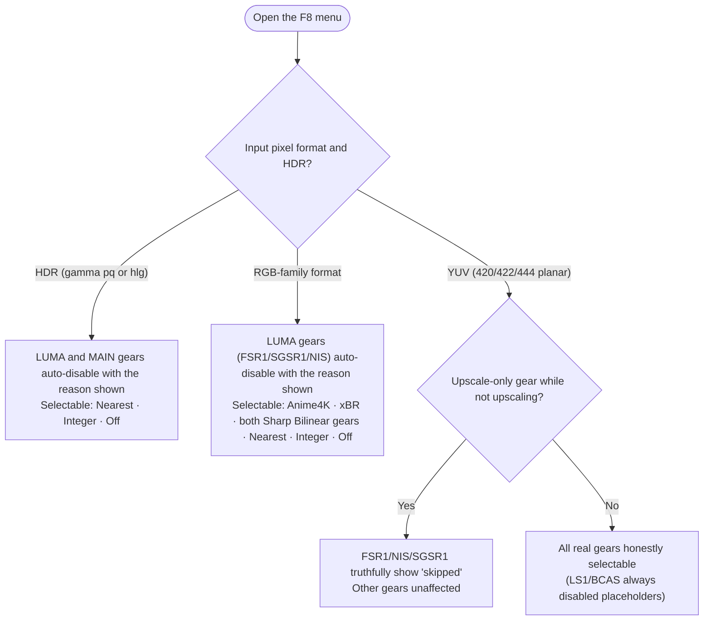

# scale-selector — Scaling Algorithm Selector for mpv

**English** | [Chinese](README_CN.md)

[](https://github.com/kkiwkK1/mpv-scale-selector/blob/main/LICENSE)
[](https://github.com/kkiwkK1/mpv-scale-selector/releases)
[](https://mpv.io)
[](https://www.lua.org)

**Press F8 to open the menu and switch scaling gears in one keystroke**: Off plus 9 real built-in gears (FSR1 / NIS / SGSR1 / Anime4K / xBR / Sharp Bilinear AUTO / Sharp Bilinear 2× / Integer / Nearest), plus two **honestly disabled placeholders**, LS1 and BCAS (LS1 is the neural-network upscaling model of Lossless Scaling; the identity of BCAS could not be verified — see the "Honest Display" section). Managed-property snapshot & restore, yielding to external changes, per-pass verification of the shader chain — the menu truthfully reflects what is actually in effect ("honest display" is the design baseline, continuously reinforced by the built-in self-test and reviews; display defects that have been fixed are listed in the [release notes](docs/%E5%8F%91%E5%B8%83%E8%AF%B4%E6%98%8E-v0.1.0.md)).

> Development and verification environment: mpv `v0.40.0-393-gad59ff1b4` + libplacebo `v7.357.0` (gpu-next), Windows; lower versions have not been tested. Machine-based objective verification is complete; **no in-person subjective image-quality evaluation has been done, and this repository makes no recommendation about image quality**.

## System Requirements

- **Operating system**: Windows — the one-click installer and all verified testing were done on Windows; other platforms are unverified and can only follow the "manual three-step" approach of copying the files yourself
- **mpv version**: all verification was done on mpv `v0.40.0-393-gad59ff1b4` + libplacebo `v7.357.0`; **no compatibility floor is claimed for lower versions** (lower versions untested)
- **Rendering backend**: verification was fixed on `vo=gpu-next` + `gpu-api=vulkan`; other VOs (including classic `vo=gpu`) are untested. Writing `vo=gpu-next` in `mpv.conf` is recommended
- **GPU**: every gear's shader compiles at startup; the NIS gear is a compute-shader implementation and needs a GPU/driver with compute support. On compile failure the plugin automatically rolls back and shows the real reason (see the FAQ)
- **Lua**: mpv must be built with LuaJIT or Lua ≥5.2 (official Windows builds use LuaJIT; PUC Lua 5.1 builds have a zoom-calculation deviation in the Integer gear — see the [release notes](docs/%E5%8F%91%E5%B8%83%E8%AF%B4%E6%98%8E-v0.1.0.md))
- **Running the tests**: Python 3, standard library only (3.9.1 in the development environment)

## Features at a Glance

- **12-gear menu**: the chain definitions of the 9 real gears are all built into the script; local configuration cannot impersonate them, swap their chains, or hang arbitrary chains on their labels; the 2 placeholder gears are permanently disabled with the reason displayed
- **Honest guards**: LUMA gears auto-disable with the real reason on RGB/HDR input; upscale-only gears (`//!WHEN`) truthfully show "skipped" when not upscaling; after activation, `vo-passes` is checked to confirm that this chain's passes really exist — on compile failure / not taking effect the plugin automatically rolls back to the previous stable state, leaving no half-applied residue
- **State machine and ownership**: off / active / external / fallback; managed properties are snapshotted before takeover and restored verbatim on "off"; external changes (e.g. a manual Anime4K chain you bound yourself in `input.conf`) win — the plugin yields, never silently overwrites, never clears chains
- **Menu experience**: ↑↓ / wheel navigation (skips disabled entries, wraps at both ends), **✓ current** marker, opens with the cursor on the current gear, keypad Enter confirms, the menu stays open after selecting a gear; plugin messages go into the menu status header instead of popping an OSD that overlaps the menu
- **Programmatic switching**: `script-message scale-selector-set <id|off>` and `scale-selector-cycle next|prev`, the same entry point and the same guard rules as the menu (for input.conf / uosc / IPC automation)
- **One-click installer**: a 21-item file manifest with per-file sha256, three-state install (copy if missing / skip if identical / back up then overwrite on conflict), read-only `-Verify`, hash-checked `-Uninstall`, idempotent re-run as upgrade
- **RIFE frame-interpolation coexistence, machine-verified: matrix 7/7 passing** (plus an environment-cleanup check): no mutual interference with vapoursynth RIFE 2× interpolation in the same process (see below)

## Gear Table (12 Gears × Algorithm × Source × License)

| # | Menu item | id | Algorithm and implementation | Source (upstream) | License |
|---|---|---|---|---|---|
| 1 | Off | `off` | Restores the `glsl-shaders` / `scale` / `cscale` / `dscale` (and Integer's geometry properties) managed before takeover; **not** equivalent to stopping the scaling and color management mpv necessarily performs | — | — |
| 2 | LS1 | `ls1` | **Disabled placeholder**: no public source code / weights / porting license — no substitute algorithm under its name | — | — |
| 3 | FSR1 | `fsr1` | AMD FidelityFX Super Resolution v1.0.2 (EASU+RCAS), LUMA gear, upscale-only (≤2× per axis; beyond that mpv's scaler takes over) | [GPUOpen-Effects/FidelityFX-FSR](https://github.com/GPUOpen-Effects/FidelityFX-FSR); mpv port by [agyild (gist)](https://gist.github.com/agyild/82219c545228d70c5604f865ce0b0ce5) | MIT |
| 4 | NIS | `nis` | NVIDIA Image Scaling v1.0.2 (compute; sharpening stage included, never stacked with NVSharpen), LUMA gear, upscale-only | [NVIDIAGameWorks/NVIDIAImageScaling](https://github.com/NVIDIAGameWorks/NVIDIAImageScaling); mpv port by [agyild (gist)](https://gist.github.com/agyild/7e8951915b2bf24526a9343d951db214) | MIT |
| 5 | SGSR1 | `sgsr1` | Qualcomm SGSR1 (LUMA-adapted version, single pass), upscale-only | [SnapdragonGameStudios/snapdragon-gsr](https://github.com/SnapdragonGameStudios/snapdragon-gsr); mpv port by [agyild (gist)](https://gist.github.com/agyild/7715b6b1f38427839d58f80884902cab) | BSD-3-Clause |
| 6 | BCAS | `bcas` | **Disabled placeholder**: the algorithm's defined identity is unverified — no impersonation via CAS / Bicubic+CAS | — | — |
| 7 | Anime4K (stock v4) | `anime4k` | Zero-modification copy of the exact stock v4 CTRL+1..6 chains set up on this machine; `anime4k_chain=a..f` selects the chain (default a = Mode A (HQ)) | [bloc97/Anime4K](https://github.com/bloc97/Anime4K) | MIT ×8 + Unlicense ×2 (per the license header embedded in each file) |
| 8 | xBR | `xbr` | Hyllian xBR-lv2 in **3× pre-scale + mpv follow-up scaling** mode (xBR ≠ xBRZ; no claim of equivalence at arbitrary ratios), MAIN gear | [libretro/glsl-shaders (xbr-lv2)](https://github.com/libretro/glsl-shaders/blob/master/xbr/shaders/xbr-lv2.glsl) | MIT |
| 9 | Sharp Bilinear AUTO | `sharpbilinear` | Automatic pre-scale `floor(output height / input height + 0.01)`; when the ratio is insufficient it explicitly says "degenerates to bilinear" instead of bending the formula for sharpness | [libretro/glsl-shaders (sharp-bilinear)](https://github.com/libretro/glsl-shaders/blob/master/interpolation/shaders/sharp-bilinear.glsl), Themaister | Public domain |
| 10 | Sharp Bilinear 2× | `sharpbilinear2x` | Fixed 2× pre-scale (named separately from AUTO, in separate files) | Same as above | Public domain |
| 11 | Integer | `integer` | Integer-multiple scaling: `k=floor(original window pixels / effective display size)`, `video-unscaled=yes` + `video-zoom` + nearest on all three scalers; at k<1 it honestly falls back to plain nearest downscaling, no cropping | mpv native properties (no third-party shader) | — |
| 12 | Nearest | `nearest` | `scale/cscale/dscale` all nearest (explicit point sampling, no shader chain) | mpv built-in | — |

The menu order matches `gears=` in `script-opts/scale-selector-gears.conf`.

**Anime4K chain modes**: `anime4k_chain=a..f` in `script-opts/scale-selector.conf` selects the chain (default a); the file composition of each chain is in the `ANIME4K_CHAINS` table in `scripts/scale-selector.lua`, and the mode names follow Anime4K stock v4 naming:

| Value | Equivalent manual key in the author's config | Mode |
|---|---|---|
| a | CTRL+1 | Mode A (HQ) |
| b | CTRL+2 | Mode B (HQ) |
| c | CTRL+3 | Mode C (HQ) |
| d | CTRL+4 | Mode A+A (HQ) |
| e | CTRL+5 | Mode B+B (HQ) |
| f | CTRL+6 | Mode C+A (HQ) |

(The manual keys come from bindings in the author's `input.conf`, configured per the official Anime4K template — **they are not keys provided by this plugin**; the plugin's gears share the same `shaders\anime4k\` files with those manual chains.) The differences are readable from the chain file composition: a/b restore with Restore_CNN variants; c/f denoise with Denoise variants before upscaling; d/e add a second Restore stage on top of a/b.

**What `gears=` can change**: this line adjusts the **menu order** and can also define custom gears (`<id>_label/_mode/_reason/_set`; disabled by default). Hard guarantees from the parser: `off` always exists, always sits first, and is always available (display name fixed as "Off"); LS1/BCAS are forced disabled no matter how they are written; `_label/_mode/_set/_reason` on built-in gears are always ineffective and produce a warning; duplicate ids keep only the first, with a warning; a new id is treated as a custom gear (greyed out unless `_mode=active` is configured). Details are in the header comments of `scale-selector-gears.conf`.

### Input Suitability (Guard Semantics)

- **LUMA gears (FSR1 / SGSR1 / NIS)**: automatically disabled with the reason shown when the input is an RGB-family pixel format or HDR (gamma ∈ {pq, hlg}); effective only when upscaling (`//!WHEN`) — when not upscaling they truthfully show "skipped" rather than a fake active
- **MAIN gears (Anime4K / xBR / the two Sharp Bilinear gears)**: usable on RGB input; automatically disabled on HDR input (an independent guard; Anime4K is in this class because all of its hooks sit at the MAIN/PREKERNEL layers)
- **nearest / Integer**: unaffected by RGB/HDR; Integer's letterboxing and k<1 fallback are both truthfully annotated

### Gear-Selection Decision Diagram

A visualization of the "Input Suitability" guard semantics above — it reflects only each gear's availability and honest display for the current input, and is not a quality recommendation:



## Menu Operation

- **F8** opens/closes; **↑ / ↓ or the wheel** moves the cursor (skipping greyed-out disabled entries, wrapping at both ends); **Enter / keypad Enter** activates the current gear (the menu stays open after a selection so you can keep switching); **Esc** closes
- The menu marks the **✓ current** gear, and the cursor rests on the active gear when it opens; while the menu is open, 7 keys (UP / DOWN / WHEEL_UP / WHEEL_DOWN / ENTER / KP_ENTER / ESC) are forcibly taken over, and the original bindings are restored verbatim after closing
- While the menu is open, plugin messages are written into the menu status header instead of a separate OSD

Switching gears without the menu (can be written into `input.conf`, and callable from uosc / IPC; the same entry point as the menu's Enter — disabled gears are rejected with the reason):

```
Alt+1  script-message scale-selector-set fsr1      # gear ids: off fsr1 sgsr1 anime4k nearest nis xbr sharpbilinear sharpbilinear2x integer
Alt+0  script-message scale-selector-set off
Alt+n  script-message scale-selector-cycle next    # or prev; skips disabled gears, wraps at both ends
```

**Changing the menu key**: set `key_menu=` in `script-opts/scale-selector.conf` to another key; **leave it empty** to skip the default binding and write `<key> script-binding scale_selector/scale-selector-menu` in `input.conf`. About F8 conflicts: mpv's factory default bindings do **not** enable F8 (the `#F8 show-text ${playlist}` line in the official keybind template `etc/input.conf` is a commented-out example — checked against build ad59ff1b4); if your own `input.conf` or other scripts bind F8, the installer checks `input.conf` during installation and emits a conflict warning.

## Installation

**Step zero: get the files** —

```
git clone https://github.com/kkiwkK1/mpv-scale-selector.git
```

No git? Download the v0.1.0 *Source code (zip)* from [Releases](https://github.com/kkiwkK1/mpv-scale-selector/releases) and unzip it. Both ways produce the same directory contents, used directly in the steps below.

The target directory is mpv's config directory (Windows default `%APPDATA%\mpv`; for portable mpv see the `-ConfigDir` usage in the FAQ).

### Option 1: One-Click Installer (Recommended)

From the repository root (double-clicking `tools\install.bat` also works):

```
powershell -ExecutionPolicy Bypass -File tools\install.ps1
```

- Installs to `%APPDATA%\mpv` by default; `-ConfigDir <directory>` points elsewhere (all testing pointed at isolated directories)
- `-Yes` skips the interactive confirmation (always include it for automated calls)
- The installer was developed and machine-tested only under **Windows PowerShell 5.1** (two rounds of isolated self-testing); PowerShell 7 (pwsh) is untested
- **Upgrade = re-run the same command**: manifest files whose hash differs from the source are automatically backed up as `<name>.bak-scale-install-<timestamp>` and then replaced; identical files are skipped (idempotent, zero changes); no need to uninstall first
- **`-Verify`**: read-only verification of the 21 manifest items (never writes to disk, never asks for confirmation); **`-Uninstall`**: hash-checks each file first and deletes only manifest files that match the source
- The installer never touches files outside the manifest such as `input.conf`, `mpv.conf`, existing scripts, or existing shaders; it backs up only on conflict and never silently overwrites

**Exit codes**:

| Code | Meaning |
|---|---|
| 0 | Success / healthy verification (including idempotent zero-change runs, a completed uninstall, and Verify 21/21 consistent) |
| 1 | Parameter / environment / IO error (unknown arguments, mutually exclusive options, declined confirmation, missing APPDATA, copy/backup/verification failure) |
| 2 | Precheck blocked (missing source file, sha256 mismatch against the resource manifest = corrupted source, manifest parse failure) |
| 3 | `-Verify` only: none of the 21 items exist (not installed) |
| 4 | `-Verify` only: some exist or hashes mismatch (inconsistent) |

### Option 2: Manual Three-Step Install

Copy the three groups of files to the matching places in the config directory (keeping the relative structure):

| Files in the repository | Copy to, under the config directory |
|---|---|
| `scripts/scale-selector.lua` | `scripts\` |
| `script-opts/scale-selector.conf`, `script-opts/scale-selector-gears.conf` | `script-opts\` |
| the whole `shaders\` directory (including the `anime4k\` subdirectory, 18 files in total) | `shaders\` |

Gear chains are referenced via the relative path `~~/shaders/…` (`~~/` is mpv's path abbreviation for the config directory): **if the `shaders\` directory or a needed file is missing, the corresponding gears stop working**, and the menu / status line truthfully shows the fallback reason.

### After Installation

- The startup log always shows 6 "override ignored" warnings (the warning text in the log is Chinese; the exact phrase and a ready-to-run check command are in the FAQ) — expected behavior of the anti-impersonation parser, not a configuration error; nothing to do
- To try the LUMA gears (FSR1/SGSR1/NIS) use YUV material — any planar format such as yuv420p/422/444 works (machine-tested with yuv420p and with RIFE-processed yuv444p; the guard rejects only RGB-family formats and HDR); these three gears being greyed out on RGB sources is by design (see below)

## "Honest Display" Design Notes

**Why LS1 / BCAS are grey**: these two gears are **never selectable**.

- **LS1**: the LS1 general neural-network upscaling model of Lossless Scaling (a commercial application on Steam; the vendor states an optimization range of roughly 1×–2×); its source code, weights, and porting/redistribution license were not obtained, so it cannot be bundled as-is, and the plugin refuses to put a different algorithm under its name (basis: [feasibility study §4.4](docs/%E5%8F%AF%E8%A1%8C%E6%80%A7%E7%A0%94%E7%A9%B6%E6%8A%A5%E5%91%8A.md)).
- **BCAS**: the name comes from the menu of the application being replicated; its full name and algorithm definition are unverified — the letters alone cannot establish it as Bicubic/Bilinear/Bilateral CAS, so the plugin refuses a placeholder under a lookalike name (basis: [feasibility study §4.5](docs/%E5%8F%AF%E8%A1%8C%E6%80%A7%E7%A0%94%E7%A9%B6%E6%8A%A5%E5%91%8A.md)).
- This is not "to be implemented"; it is a hard guarantee at the parser layer: no matter how the local configuration is written, these two ids are forced disabled and use built-in fixed reason text. CAS-related research material is not distributed with the plugin; see [licenses/CAS-SOURCE-NOTES.md](licenses/CAS-SOURCE-NOTES.md).

**LUMA gears greyed out on RGB sources**: by design, not a malfunction. The LUMA gears (FSR1/SGSR1/NIS) work in the YUV luma channel; on RGB or HDR input the guard refuses them and the menu shows the real reason; switch to YUV material to activate them (420/422/444 planar formats all work). Anime4K / xBR / Sharp Bilinear support RGB (HDR is still refused).

**Other honest semantics**: FSR1/SGSR1/NIS take effect only when upscaling and explicitly say "skipped" otherwise; Sharp Bilinear AUTO explicitly says "degenerates to bilinear" when the ratio is insufficient; Integer's letterboxing and k<1 fallback are both truthfully annotated; choosing "Off" restores the managed properties recorded before the plugin's takeover — it does not mean stopping the scaling and color management mpv necessarily performs.

## Coexistence with RIFE Frame Interpolation (Matrix Machine-Verified 7/7)

Machine-verified in a real environment where mpv.conf-level `vf vapoursynth` RIFE 2× interpolation stays enabled ([full report](docs/%E6%8F%92%E4%BB%B6/rife%E5%85%BC%E5%AE%B9%E6%80%A7%E6%8A%A5%E5%91%8A-2026-10-11.md)): all 7 matrix cases pass, plus an environment-cleanup check —

- With RIFE on, every gear (FSR1/xBR/Nearest, etc.) activates normally, the shader chain really mounts, and `estimated-vf-fps` stays at 2× the source frame rate throughout
- With a gear active, toggling RIFE with F7 leaves the plugin's managed properties verbatim; the F8 menu and F7 do not steal each other's keys; "Off" restores the baseline
- One verified correction: the LUMA guard looks only at the **output-side** pixel format — an RGB source outputs yuv444p after RIFE, and the LUMA gears are then selectable and usable; the by-design disable triggers only on RGB passthrough (RIFE off)

## Quality Assurance

- **Tests**: 646 cases in `tests/` + 51 cases in `taskflows/` (static `def test_` count, 2026-10-12). Run (~3 minutes):

  ```
  python -B -X utf8 -m unittest discover -s tests -p "test_*.py"
  python -B -X utf8 -m unittest discover -s taskflows -p "test_*.py"
  ```

  On a clean checkout (without the local evidence tree) the machine-verified run was `Ran 646 / OK (skipped=36)` — the 36 P4 cases depend on a local evidence tree deliberately kept out of the repository ([evidence retention policy](docs/%E9%AA%8C%E8%AF%81/%E8%AF%81%E6%8D%AE%E7%95%99%E5%AD%98%E7%AD%96%E7%95%A5.md)); when evidence is missing they auto-skip with the reason noted. The current development branch additionally has 24 cases that **fail by design** locally (fail-closed = rather fail than let pass): after the source rectification, the resource-integrity baseline recorded during development has not yet been re-stamped under the established process (informally called "re-sealing"), and the related tests wait for that process to conclude; plugin functionality is unaffected — see [review and improvement notes (2026-10-12)](docs/%E8%AF%84%E5%AE%A1%E4%B8%8E%E6%94%B9%E8%BF%9B%E5%BB%BA%E8%AE%AE-2026-10-12.md).

  **Reproducing the built-in Lua self-test (124 cases)**: the self-test is triggered via `script-message scale-selector-selftest`, logs each case (`selftest: PASS/FAIL <case name>`), and ends with the summary `selftest finished: pass/fail cases: N failures: M` (`scripts/scale-selector.lua:2700`). Isolated reproduction (without touching your daily configuration):

  ```bat
  powershell -ExecutionPolicy Bypass -File tools\install.ps1 -ConfigDir "%TEMP%\scale-selftest" -Yes
  mpv --config-dir="%TEMP%\scale-selftest" --idle=yes --force-window=no --input-ipc-server=scale-selftest --log-file="%TEMP%\scale-selftest.log"
  ```

  In another terminal, save the following 4 lines as `selftest_pipe.py` and run `python selftest_pipe.py`:

  ```python
  import json
  f = open(r'\\.\pipe\scale-selftest', 'r+b', buffering=0)
  f.write((json.dumps({'command': ['script-message', 'scale-selector-selftest']}) + '\n').encode())
  print(f.readline().decode())
  ```

  Read the selftest lines in `%TEMP%\scale-selftest.log` for the result.
- **Development-phase verification toolchain** (`tools/`; P1–P4 are this project's internal numbering of its four development phases — see the [phase index](docs/%E9%98%B6%E6%AE%B5%E7%B4%A2%E5%BC%95.md) for the mapping): third-party-resource sha256 audit and manifests (`shaders/resource-manifest.json`, `shaders/p3-resource-manifest.json`), Lua behavior mirror checking, an Integer geometry oracle, performance capture and analysis, and mpv configuration backup/restore.
- **Acceptance evidence**:
  - One-click installer: two rounds of isolated self-testing covering fresh install / idempotent re-run / conflict backup / `-Verify` / uninstall round-trip plus mutually exclusive options, unknown arguments, corrupted source, and other abnormal paths, with exit codes machine-checked as returned — see [installation walkthrough (one-click install)](docs/%E6%8F%92%E4%BB%B6/%E5%AE%89%E8%A3%85%E6%B5%81%E7%A8%8B-%E6%97%A5%E5%B8%B8mpv.md)
  - Daily mpv installation: 21/21 triple hash verification, zero changes to 54 pre-existing files, GUI machine-tested OK (F8 menu, FSR1 activation with chain verification, baseline restore, no traceback in the entire log) — see the [installation report](docs/%E6%8F%92%E4%BB%B6/%E5%AE%89%E8%A3%85%E6%8A%A5%E5%91%8A-2026-10-12.md)
  - RIFE coexistence matrix 7/7: see above
- **Boundary**: all of the above is machine-based objective verification; in-person subjective image-quality evaluation has not been done, and P4 image-quality/performance measurement is ongoing and not yet closed out — **this repository makes no recommendation about image quality**.

## Third-Party Credits

Third-party shaders bundled/adapted in this plugin — upstream, license, and this repository's attribution notes (adapted versions only append provenance comments and stand up their own SHA-256; the main algorithm/instruction lines are unchanged; the base files' source URL, fetch time, and hash are registered in [provenance index](docs/%E8%AF%81%E6%8D%AE/%E7%A7%BB%E6%A4%8D%E5%8F%96%E8%AF%81%E7%B4%A2%E5%BC%95.json)):

| Component | In this repository | Upstream | License | Attribution notes |
|---|---|---|---|---|
| AMD FSR 1.0.2 | `shaders/p2-FSR1.glsl` (adapted) | [GPUOpen-Effects/FidelityFX-FSR](https://github.com/GPUOpen-Effects/FidelityFX-FSR); mpv port [agyild gist](https://gist.github.com/agyild/82219c545228d70c5604f865ce0b0ce5) | MIT | [licenses/FSR1-LICENSE-NOTES.md](licenses/FSR1-LICENSE-NOTES.md) |
| NVIDIA Image Scaling 1.0.2 | `shaders/p3-NIS.glsl` (adapted) | [NVIDIAGameWorks/NVIDIAImageScaling](https://github.com/NVIDIAGameWorks/NVIDIAImageScaling); mpv port [agyild gist](https://gist.github.com/agyild/7e8951915b2bf24526a9343d951db214) | MIT | [licenses/NIS-LICENSE-NOTES.md](licenses/NIS-LICENSE-NOTES.md) |
| Qualcomm SGSR1 | `shaders/p2-SGSR1.glsl` (LUMA-adapted) | [SnapdragonGameStudios/snapdragon-gsr](https://github.com/SnapdragonGameStudios/snapdragon-gsr); mpv port [agyild gist](https://gist.github.com/agyild/7715b6b1f38427839d58f80884902cab) | BSD-3-Clause | [licenses/SGSR1-LICENSE-NOTES.md](licenses/SGSR1-LICENSE-NOTES.md) |
| Anime4K v4 | `shaders/anime4k/` (zero-modification copy, 10 files) | [bloc97/Anime4K](https://github.com/bloc97/Anime4K) | MIT ×8 + Unlicense ×2 (per file header) | [licenses/ANIME4K-LICENSE-NOTES.md](licenses/ANIME4K-LICENSE-NOTES.md) |
| Hyllian xBR-lv2 | `shaders/p3-xBR-lv2.glsl` (adapted) | [libretro/glsl-shaders](https://github.com/libretro/glsl-shaders/blob/master/xbr/shaders/xbr-lv2.glsl) | MIT | [licenses/XBR-LICENSE-NOTES.md](licenses/XBR-LICENSE-NOTES.md) |
| Sharp Bilinear | `shaders/p3-Sharp-Bilinear-AUTO.glsl`, `shaders/p3-Sharp-Bilinear-2x.glsl` (adapted) | [libretro/glsl-shaders (Themaister)](https://github.com/libretro/glsl-shaders/blob/master/interpolation/shaders/sharp-bilinear.glsl) | Public domain | [licenses/SHARP-BILINEAR-LICENSE-NOTES.md](licenses/SHARP-BILINEAR-LICENSE-NOTES.md) |

Adaptation hashes are recorded in `shaders/resource-manifest.json` and `shaders/p3-resource-manifest.json` (the installer's precheck also uses them to detect corrupted sources).

> Note: the `docs/证据/` provenance-artifact directory is **kept in the repository** (`.gitattributes` disables line-ending normalization for it to keep the bytes identical); unlike it, the "evidence not committed" policy refers only to the per-session verification evidence tree under `docs/验证/开发/` (see the [evidence retention policy](docs/%E9%AA%8C%E8%AF%81/%E8%AF%81%E6%8D%AE%E7%95%99%E5%AD%98%E7%AD%96%E7%95%A5.md)) — the two do not conflict, and the provenance links above always resolve inside the repository.

## FAQ

**F8 does nothing?** Check in order:

1. **Script not loaded**: confirm that `scripts\scale-selector.lua` and the three `script-opts\scale-selector*.conf` files are in place; check the startup log for script errors (how to read the log — next entry).
2. **Fn / F-Lock**: on laptops where F8 is mapped to a media function key, press Fn+F8 or toggle F-Lock. Discriminator: if `script-message` can switch gears but the physical key cannot → the problem is in the OS keyboard layer, not the plugin.
3. **Window focus**: the mpv window must be in the foreground; the menu key is received by the mpv process.
4. **Key rebound/taken**: check whether `input.conf` binds F8, or whether `key_menu=` in `scale-selector.conf` has been changed. See "Menu Operation" for how to rebind or leave it empty.

**How do I read the startup log?** Run `mpv` directly in cmd/PowerShell (rather than double-clicking a shortcut) and the log prints to the console; or add `--log-file=<path>` on the command line to write it to a file (an mpv manual option). To check the expected warnings: `findstr /c:"覆盖被忽略" <log file>` should hit 6 lines (the quoted string is the literal warning text, in Chinese — "override ignored").

**The gear bounces back within seconds of selecting it (with a reason shown)?** That is the automatic rollback after chain-verification failure: the shader failed to compile or did not take effect — common with older GPUs/drivers, or without `vo=gpu-next`. Troubleshooting order: update the GPU driver → confirm `vo=gpu-next` → try other gears to cross-locate the problem (LUMA and MAIN gears use different resources) → look for libplacebo/shader compile error lines in the log. The plugin rolls back to the previous stable state, leaving no half-applied residue.

**The state suddenly becomes "external" when selecting a gear?** Those keys do not come from this plugin — they come from manual Anime4K chains bound in your own `input.conf` (commonly F6, Ctrl+1..6, directly `change-list glsl-shaders`). Such external changes make the plugin yield (external wins, no silent overwriting); that is coexistence design, not a fault — you will never see it without such bindings.

**6 "override ignored" warnings in the startup log?** Expected: fixed warnings from the anti-impersonation parser for override keys of built-in/placeholder gears; nothing to handle.

**Will F8 conflict with other bindings?** mpv's factory default bindings do not enable F8 (see "Menu Operation"). If your own `input.conf` binds F8 (including un-commenting `#F8 show-text ${playlist}` when using the official template), it conflicts with the default `key_menu=F8` — the installer checks `input.conf` during installation and warns; if you mind, change `key_menu=` to another key, or leave it empty and use `script-binding scale_selector/scale-selector-menu` instead.

**How do I install for portable mpv?** Install, verify, and uninstall all support `-ConfigDir` — point it at the portable config directory: `powershell -ExecutionPolicy Bypass -File tools\install.ps1 -ConfigDir "<directory containing mpv.exe>\portable_config"` (same parameter for `-Verify`/`-Uninstall`).

**Want to uninstall?** `powershell -ExecutionPolicy Bypass -File tools\install.ps1 -Uninstall` — it hash-checks each file first and deletes only the 21 manifest files that match the source; mismatches (files you edited, or installed from an older build) are **refused deletion** and listed item by item — once you confirm you don't want them, delete them manually by their manifest paths. `.bak-scale-install-<timestamp>` backups and `input.conf`/`mpv.conf`/pre-existing files are never touched, so no configuration needs restoring. Backups from upgrades accumulate in the original directory; keep or delete them as you like — as a side note, `.bak` backups under `scripts\` get seen by mpv's directory scan and leave one harmless load error in the log (one case observed in the daily installation report); delete the backups if you mind.

## Documentation Index

- [Phase index](docs/%E9%98%B6%E6%AE%B5%E7%B4%A2%E5%BC%95.md): the role and current validity of each document under docs
- [User guide (state machine, guard and restore semantics in detail)](docs/%E6%8F%92%E4%BB%B6/%E7%BC%A9%E6%94%BE%E9%80%89%E6%8B%A9%E5%99%A8-P3%E7%94%A8%E6%88%B7%E8%AF%B4%E6%98%8E.md)
- [Review and improvement notes (2026-10-12)](docs/%E8%AF%84%E5%AE%A1%E4%B8%8E%E6%94%B9%E8%BF%9B%E5%BB%BA%E8%AE%AE-2026-10-12.md): 43 findings and fix records
- [Verification evidence retention policy](docs/%E9%AA%8C%E8%AF%81/%E8%AF%81%E6%8D%AE%E7%95%99%E5%AD%98%E7%AD%96%E7%95%A5.md): the default decision to keep the evidence tree out of the repository and archive it externally
